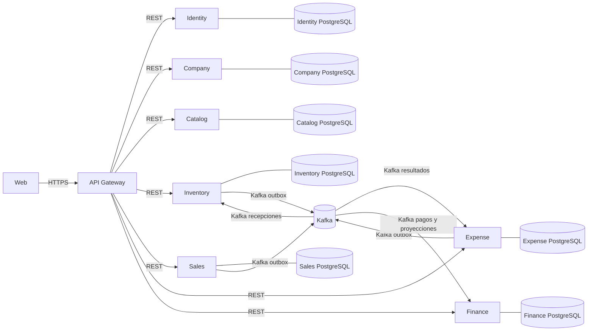
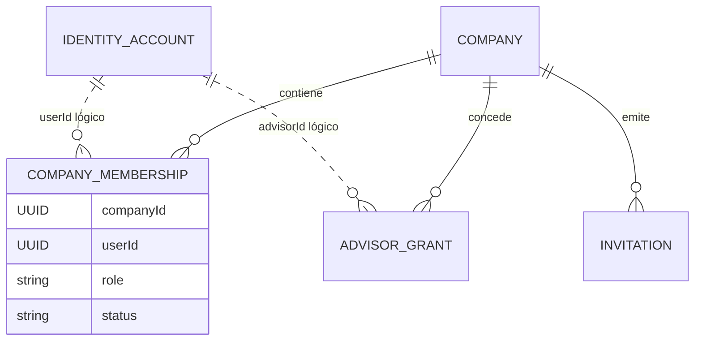
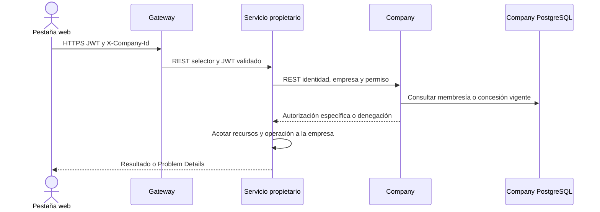
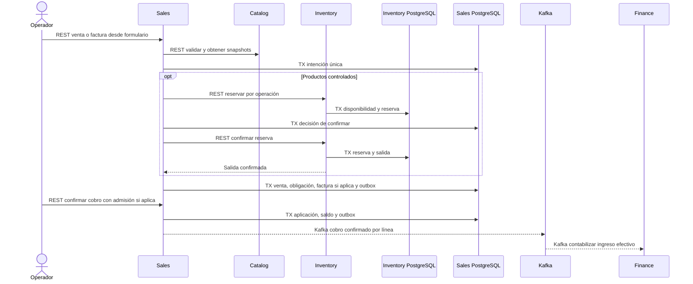
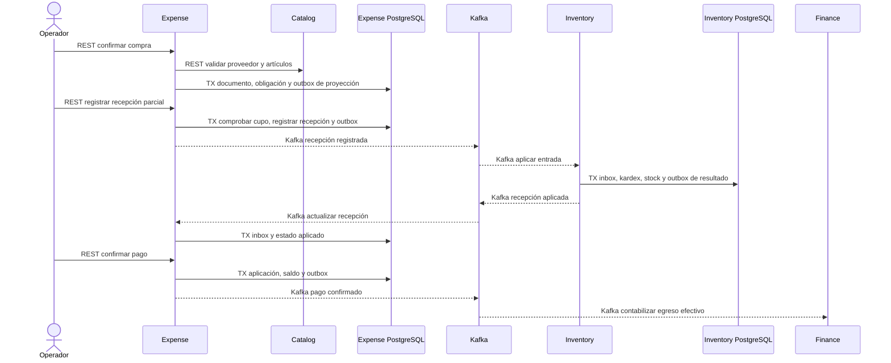
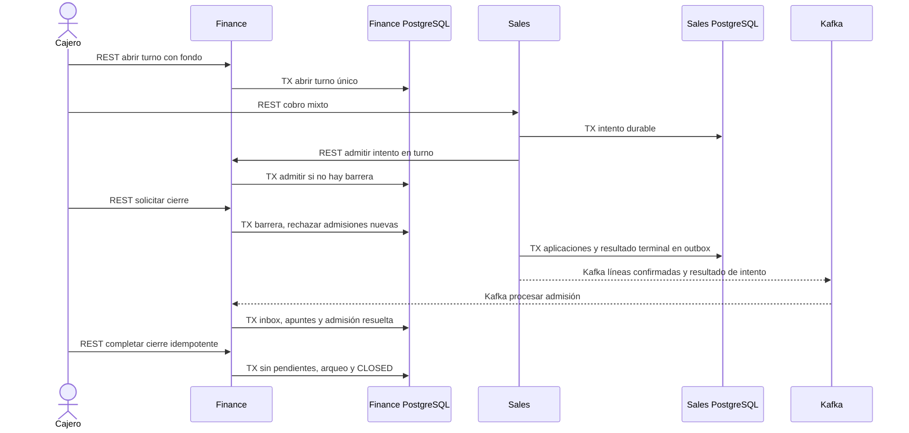
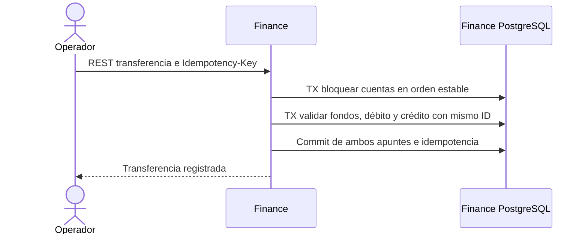
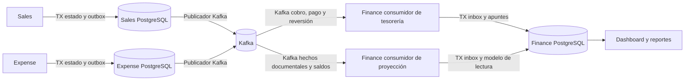

# ADR-002 · Evolución multiempresa, inventario y finanzas

**Estado** Propuesto para revisión en S2-452. El [contrato v0.8](../SaniGest_T1001_Contrato_Funcional_v0.8.md) es el objetivo de desarrollo sujeto a esa revisión. La [trazabilidad](../traceability/ui-backend-matrix-v0.8.md) enlaza los tickets de implementación. El [ADR-001](ADR-001-propiedad-datos-comunicacion-servicios.md) permanece como registro histórico y referencia para las decisiones conservadas.

## Contexto y decisión

Las nuevas pantallas necesitan varias empresas por cuenta regular, almacenes, recepciones, facturas desde formulario, caja por turno y liquidación por medios mixtos. Estas capacidades cruzan dominios cuyo dato y transacción deben tener un propietario.

| Tratamiento del ADR-001 y v0.7 | Decisión v0.8 |
| --- | --- |
| Se mantiene | Java 21, PostgreSQL/Flyway por servicio, contratos REST/Kafka versionados, snapshots, outbox, idempotencia, seguridad local, Redis reconstruible, parámetros de resiliencia, caja efectiva separada del devengo. ECR, ECS/Fargate y RDS para el MVP, Compose local y kind para validación, EKS sujeto a otro ADR. |
| Evoluciona | Inventory asume existencias físicas. Finance asume cuentas, transferencias y sesiones, con proyecciones para dashboard y reportes. Facturación interna admite formulario además de venta registrada. Expense separa documento, recepción y pago. |
| Se sustituye en el objetivo | Empresa única y resolución implícita por usuario. El flujo del ADR-001 §9.1 conserva atomicidad y elimina la condición «sin empresa». El cobro por caja de §9.2 añade admisión y barrera de cierre. Los movimientos admiten una aplicación única por línea confirmada en cobros mixtos. |

DDD y bounded contexts delimitan cambios y fuente de verdad. Un servicio por pantalla o entidad dispersaría invariantes y aumentaría llamadas. Clientes/proveedores quedan en Catalog, impuestos como clasificación versionada evaluada al documentar, facturas/cobros en Sales y cuentas por pagar en Expense. Un límite nuevo exige ADR con propiedad e invariantes propias.

## Contenedores y límites

| Contexto | Agregados y fuente de verdad | Dependencias permitidas |
| --- | --- | --- |
| Identity | Cuenta, credenciales, perfil, sesiones | JWT propio, ninguna BD externa |
| Company | Empresa, membresías, invitaciones, permisos, concesiones y auditoría | Identity para existencia/estado de la cuenta |
| Catalog | Cliente, proveedor, artículo y relación de suministro | Company para permisos, lectura compuesta de Inventory para stock |
| Inventory | Almacén, existencia, reserva, kardex | Company y Catalog, comandos Sales, hechos Expense |
| Sales | Venta, factura interna, obligación y cobro | Company, Catalog, Inventory y admisión Finance |
| Expense | Compra/gasto/activo, recepción, obligación y pago | Company, Catalog, validaciones Inventory y cuentas Finance |
| Finance | Cuenta, movimiento, turno, transferencia y proyecciones | Company, hechos Sales/Expense, REST de composición transitorio |
| API Gateway | Routing y autenticación de borde, sin persistencia de negocio | Rutas públicas y configuración de confianza |

Cada servicio de negocio tiene PostgreSQL, credenciales y Flyway propios. Toda asociación externa usa UUID y snapshots selectivos. Quedan prohibidas consultas, vistas, joins, FK, repositorios, entidades JPA y transacciones entre servicios. Gateway no autoriza por delegación de los dominios ni publica rutas internas. Integraciones inversas se acotan a consultas sin ciclos síncronos para el mismo comando.



Las líneas sin flecha representan propiedad exclusiva. La matriz siguiente incluye las dependencias internas omitidas del diagrama de contenedores.

## Capas y librerías

Organización de referencia, adaptada a la [guía de servicios](../development/new-service.md). Las divisiones se crean cuando existe una responsabilidad concreta.

```text
services/<domain>-service/
├── pom.xml
└── src/
    ├── main/
    │   ├── java/com/sanigest/<domain>/
    │   │   ├── api/{controller,dto,error}
    │   │   ├── application/{usecase,dto,exception,port/out}
    │   │   ├── domain/{model,enums}
    │   │   └── infrastructure/{persistence,integration,messaging,security}
    │   └── resources/db/migration/
    └── test/
```

API valida entradas HTTP, traduce errores y delega en casos de uso por capacidad. Application coordina y delimita transacciones locales. Domain contiene modelos, invariantes y políticas libres de Spring, HTTP, Kafka y persistencia. Infrastructure adapta PostgreSQL, REST, Kafka, almacenamiento y seguridad. Ports & Adapters invierte las dependencias salientes sin que Application importe adaptadores concretos. Controladores sin acceso a repositorios y DTO HTTP sin persistencia directa. Evitar servicios genéricos, interfaces, factories y mappers sin responsabilidad demostrada. Seguir ArchUnit, Enforcer, Checkstyle y Spotless existentes. Los límites de persistencia y seguridad permanecen locales. El [catálogo de librerías](../../libraries/README.md) indica módulos existentes y candidatos.

## Multiempresa



La relación con Identity es lógica y cruza bases solo por UUID. Company garantiza al menos un OWNER activo. Hoy CreateCompanyUseCase usa `hasMembership(userId)` y `JdbcCompanyRegistrationStore` delega a `existsByUserId`. GetMyCompanyUseCase consulta `findCompanyByUserId`; UpdateMyCompanyUseCase y equipo operan con resolución singular. ResolveCompanyAccess llama `findActiveAccess(userId, permission)` y la rama ADVISOR ya recibe companyId. JdbcMembershipRepository asume resultados individuales por usuario y mapea conflictos de alta a empresa única. Flyway V2 tiene unicidad `(company_id,user_id)` y V3 añade `uq_company_memberships_user` global. S2-453 conserva V2, quita el índice/restricción global mediante migración nueva, mantiene idempotencia actor/clave y ajusta altas concurrentes. S2-454 migra a resolución por par y selección inequívoca. S2-455 aplica el modelo a invitaciones y membresías.

Se evaluaron empresa guardada en sesión y JWT por empresa. La sesión global produciría carreras entre pestañas y un JWT por empresa obligaría a emitir tokens al seleccionar, con riesgo de permisos obsoletos. Se adopta selector por petición y verificación dinámica. La compatibilidad singular se limita a la resolución inequívoca documentada en v0.8.



No reutilizar una autorización de otra empresa ni conservar positivos más allá de revocación. Company verifica estado de cuenta con Identity según contrato vigente. Ausencia de resolución confiable falla cerrada. Cachés cache-aside por servicio, ambiente, tenant, filtros y versión, con TTL, métricas e invalidación. Mantener saldos, inbox e idempotencia en PostgreSQL.

## Venta e inventario

Alternativas evaluadas: descontar stock después de registrar una venta permite sobreventa. Confirmar salida síncronamente antes de persistir intención en Sales deja salidas huérfanas ante timeout. Se elige saga orquestada por Sales, con intención durable, reserva síncrona y confirmación idempotente recuperable antes de publicar venta registrada. Para artículos no controlados se completa localmente. Los borradores permanecen sin efectos. Estados internos pendientes no se confunden con REGISTERED.

1. Sales persiste intención única y snapshot, y solicita reserva de todas las líneas controladas con el mismo ID de operación. Inventory bloquea y valida disponibles en una transacción.
2. Sales persiste decisión de confirmar y reintenta desde el coordinador durable con backoff. Inventory confirma una vez, convierte retención a salida y devuelve su resultado. Un error ambiguo se resuelve consultando o reejecutando el mismo comando, sin crear otro ID. Si la reserva expiró antes de confirmar, se aborta la intención o se inicia una nueva operación explícita. El vencimiento libera solo HELD bajo el mismo bloqueo que confirmación.
3. Sales registra venta, obligación exigible y factura solicitada en una transacción local con outbox de proyección. Si falla tras la salida, recupera la intención y finaliza. Ante fallo terminal, bloquear finalización y solicitar reversión de salida correlacionada y única. Antes de salida se libera reserva. Cancelación posterior usa la misma disciplina y conserva el historial.



## Compra, recepción y pago

Expense valida proveedor y elegibilidad del artículo con Catalog y el almacén con Inventory. Admite recepciones por línea bajo bloqueo o versión y limita el neto aplicado más lo pendiente a la cantidad comprada. Inventory consume el hecho y registra stock, inbox y respuesta outbox juntos. Expense confirma recepción aplicada con el resultado. Un fallo transitorio reintenta de forma durable. Un rechazo definitivo libera el cupo tras constatar ausencia de efecto. Las reversiones siguen el orden del original y tienen identidad propia.



## Turno de caja y cobro mixto

Alternativas: consultar OPEN y cobrar después deja una carrera con cierre. Cerrar tras esperar un intervalo Kafka no distingue lag de un cobro perdido. Se adopta admisión durable en Finance, vinculada a empresa, turno, intento Sales, medios e importes máximos, y barrera bajo el mismo bloqueo de sesión.

- Sales registra intento durable antes de pedir admisión. Finance admite solo en OPEN y sin barrera y devuelve ID único. Sales confirma o aborta el intento con actualización condicional indivisible y emite resultado terminal. Una admisión sola no crea movimiento. Bloquear obligación al aplicar y registrar cada línea confirmada con su cuenta destino. Finance contabiliza cada línea y marca admisión resuelta solo cuando recibió el manifiesto terminal y aplicó todas las líneas admitidas confirmadas.
- El cierre activa barrera persistente, conserva estado OPEN con `closing=true`, y rechaza nuevas admisiones y movimientos manuales del turno. Retorna 202 mientras haya admisiones pendientes. Una vez drenadas permite snapshot y CLOSED en una transacción local con arqueo definitivo. Si una liquidación no efectiva queda pendiente, Sales debe fijar esa línea irrevocablemente como liquidación posterior fuera del turno, conservando su identidad y cuenta. Se excluye del arqueo y se contabiliza a su confirmación, sin reabrir caja.
- Tras timeout, consultar intento por ID o reintentar comandos idempotentes. Para liberar una admisión abandonada, Sales debe registrar aborto terminal que impida confirmación posterior. No expirar una admisión que quizá confirmó y perdió respuesta. Si la autoridad no responde, mantener cierre pendiente y alertar. Un evento tardío de admisión previa se contabiliza mientras la barrera drena. Tras CLOSED solo caben duplicados ya procesados o liquidaciones/correcciones fuera del turno; discrepancias se envían a conciliación sin reescribir el cierre.



## Transferencias internas



## Comunicación y proyecciones

| Origen → destino | Mecanismo y contrato | Propietario | Límite y fallo | Idempotencia |
| --- | --- | --- | --- | --- |
| Web → Gateway → servicios | HTTPS/REST OpenAPI y JWT/selector | Servicio destino | Presupuesto interno, 503/504 | Clave en comando |
| Dominios → Company → Identity | REST resolución empresarial y estado de cuenta | Company/Identity por contrato | Fallar cerrado, 503 | GET |
| Sales/Expense/Inventory → Catalog | REST validación y snapshot | Catalog | Validación indispensable falla 503 | GET |
| Sales → Inventory | REST reservar, confirmar, liberar, revertir y consultar | Inventory | 503 o intención pendiente ante resultado ambiguo | ID operación y efecto |
| Expense → Inventory/Finance | REST validar almacén/cuenta | Inventory/Finance | 503 si no se puede verificar | GET |
| Expense ↔ Inventory | Kafka recepción, reversión, resultado | Emisor de cada hecho | Asíncrono, pendiente hasta resultado, DLQ | Inbox y clave de recepción/efecto |
| Sales → Finance | REST admisión y consulta de turno/intento | Finance | 503 o recuperación por ID | ID intento |
| Sales/Expense → Finance | Kafka cobro, pago, reversión y proyección; resultado de intento de Sales | Emisor | Asíncrono, outbox/DLQ y conciliación | Inbox y unicidad por efecto |
| Finance/Catalog o ficha compuesta → fuentes | REST lectura temporal permitida | Cada fuente | 503 o parcial declarado con frescura | GET |

REST conserva conexión 500 ms y límite total remoto 2 s. Cero reintentos automáticos de comandos, GET idempotentes hasta dos reintentos con backoff y jitter dentro del presupuesto, nunca 4xx. Circuit breaker por dependencia, ventana 20, mínimo 10, umbral 50 %, apertura 30 s y bulkhead por cliente. No contabilizar 401/403/404/409/422 como fallo del circuito. Recuperación durable de saga usa comandos idempotentes explícitos, distinta del retry transparente HTTP. Correlacionar traceId y medir latencia, fallos, retries y saturación.

Kafka conserva `ReceivablePaymentRegisteredV1` y `PayablePaymentRegisteredV1` como hechos de confirmación, con `sourceId` identificando la aplicación confirmada por línea en contratos nuevos. Si los consumidores esperan otro significado, versionar antes de emitir. Las reversiones tienen evento y efecto propios, referencian el original y nunca lo sobrescriben. Proyecciones separadas propuestas: `SaleRegisteredV1`, `SaleCancelledV1`, `InternalInvoiceIssuedV1`, `ExpenseRegisteredV1`, `ExpenseCancelledV1` y `ObligationBalanceChangedV1` (incluye saldos iniciales). Contratos propuestos de Inventory: `PurchaseReceiptRegisteredV1`, `PurchaseReceiptReversedV1` y `InventoryReceiptResultV1` con resultado aplicado o rechazo definitivo. El manifiesto `CashCollectionAttemptResolvedV1` enumera IDs de aplicaciones admitidas, abortadas y derivadas a liquidación externa. El resultado terminal se emite desde Sales con la decisión durable, en la misma transacción que el outbox.

Envelope con eventId, eventType, version, occurredAt UTC, companyId, sourceId, traceId y datos de negocio mínimos, más amount/currency para importes, cuenta/medio para tesorería, fecha efectiva y correlación cuando apliquen. Partition key `companyId` como ADR-001; orden por partición y topic, no global. Proyecciones llevan versión del agregado y fecha de negocio. Detectar saltos o dependencias causales (reversión antes del original o manifiesto antes de sus líneas) y dejar pendientes de reaplicación o conciliación, sin aplicar dos veces. Publicar esquemas compatibles y validar consumidores antes de nuevas versiones. Evitar serializar entidades o PII innecesaria.

Cambio de dominio y outbox en una transacción de origen. Inbox y efecto en una transacción de destino, unicidad `(companyId, origin, sourceId)` por aplicación o reversión efectiva. La entrega es al menos una vez. Retries acotados con backoff y DLQ con causa y trazabilidad; replay autorizado y auditado preserva identidad. Medir lag, antigüedad outbox, DLQ, pendientes de stock/caja y diferencias por empresa. Reconciliar pagos, reversiones y movimientos por IDs e importes usando contratos propietarios, con reparación idempotente. Read Models y CQRS selectivo en Finance, Java/PostgreSQL y API Composition solo donde falte proyección. No Event Sourcing completo ni transacciones distribuidas.



## Migración, consecuencias y riesgos

1. S2-453 prepara listado y creación múltiple con migración nueva y backfill comprobado. Coordinar activación con S2-454, evitando habilitar varias membresías mientras existan consumidores singulares sin protección. S2-454 despliega validación explícita en Gateway, Company, librería técnica y dominios, con pruebas de rutas directas, compatibilidad y corte de clientes. Después S2-455 amplía invitaciones y permisos.
2. Evolucionar Catalog y Sales mediante campos y lectores compatibles. Preservar IDs, snapshots, facturas, saldos, timestamps y claves de idempotencia. Las ventas CASH antiguas requieren reconciliación antes de derivar obligaciones faltantes, sin generar cobros históricos ficticios. No asignar tasas o categorías históricas sin evidencia. Versionar rutas o representaciones con cambio incompatible.
3. Habilitar Inventory primero para altas explícitas, saldos iniciales auditados y operaciones nuevas. Incorporar Expense y Finance con esquemas propios, activar recepciones, caja y proyecciones por capacidad, validar contra fuentes y conservar checkpoints para replay. Eliminar fallback singular solo tras migrar clientes y confirmar la telemetría, salvo compatibilidad explícita de /me.
4. Expandir, rellenar, verificar, activar y endurecer mediante migraciones sucesivas. No editar migraciones aplicadas. Ante regresión, detener activación y conservar datos/outbox. Una vuelta al código singular requiere impedir nuevas resoluciones multivalor, sin borrar membresías. No reabrir tickets Done.

La autorización dinámica añade latencia y dependencia de Company; usar presupuestos y fail-closed. La saga añade estados pendientes, reconciliación y runbooks; medir expiraciones y evitar duplicación con IDs estables. Cierre puede quedar pendiente ante caída de Sales o Kafka; recuperar primero las admisiones. Proyecciones son eventualmente consistentes y declaran frescura. La validación tributaria, la política exacta de vencimiento/reservas operativas, límites de adjuntos y rollouts se cierran en sus tickets. Python/FastAPI queda como evaluación S2-470.

## Tickets y pruebas

Antecedentes S2-293 y S2-303. Evolución S2-452 a S2-470 y tickets existentes de Company S2-308/309/311/312/317/330, Sales S2-332 a S2-341 y S2-378, Expense y Finance S2-342 a S2-359, S2-384/386/387, S2-416 a S2-420 y S2-423 según [matriz](../traceability/ui-backend-matrix-v0.8.md).

Historias de implementación deben cubrir unitarias de invariantes, PostgreSQL Testcontainers para migraciones y bloqueos, contratos REST/Kafka, ArchUnit, smoke HTTP real y regresión. Probar aislamiento entre empresas y ADVISOR, revocación, concurrencia de saldo/stock/cierre, duplicados, reversiones, replay y reconciliación. Mantener Surefire, Failsafe y perfiles smoke/regression. S2-452 es documentación y se valida mediante diff, enlaces, diagramas y coherencia cruzada.
